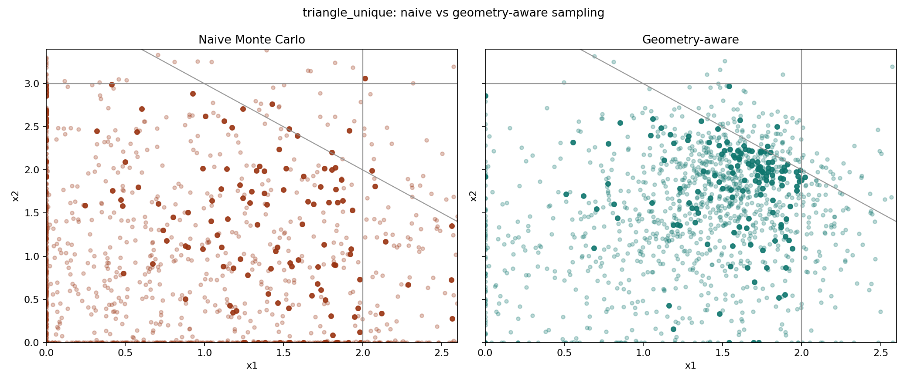

# Geometry-Aware LP Adaptive Sampling

[](https://www.python.org/)
[](LICENSE)

A research-oriented Python framework for discovering the active constraints and
candidate vertices of dense linear programs through adaptive primal-dual sampling.
The project combines probabilistic search with deterministic vertex reconstruction,
validates every candidate for feasibility, and uses SciPy/HiGHS as the reference
solver.



## Why this project

Linear-programming optima occur at the boundary of a feasible region. Instead of
searching only for a high objective value, this project asks whether a sampler can
learn the *geometry* of that boundary: which constraints repeatedly become active,
which samples cluster around promising corners, and whether those patterns can be
turned into useful solver hints.

The end-to-end pipeline is:

```text
sample primal/dual candidates
        -> optionally refine with directed primal-dual (PDHG) steps
        -> score feasibility, gap, complementarity, and geometric support
        -> infer soft active sets
        -> reconstruct and polish candidate vertices
        -> verify feasibility
        -> compare with HiGHS
```

## Directed primal-dual experiment

The solver now supports `sampling`, `pdhg`, and `hybrid` search modes. The hybrid
refines sampled candidates with PDHG before updating its sampling distribution,
while retaining a continuous deterministic trajectory. Sampling remains the
default.

The [method walkthrough](docs/PRIMAL_DUAL_HYBRID.md) explains the updates,
configuration, correctness checks and limitations. The
[matched-time comparison](outputs/benchmarks/primal_dual_comparison/summary.md)
compares all three modes on four synthetic LP families, with vertex polishing
disabled and failures retained in success-rate denominators.

The [follow-up investigation](docs/PRIMAL_DUAL_FOLLOWUP.md) adds an optional primal
recovery stage shared by all three modes, tests smaller batches and deeper
updates, and validates recovery on held-out seeds with up to 40 variables.
Its [validation report](outputs/benchmarks/primal_dual_followup/validation/summary.md)
includes paired success-rate differences and uncertainty intervals.

The [external PDLP pilot](outputs/benchmarks/pdlp_comparison/pilot/findings.md)
compares our recovery procedure with established polishing on three public sparse
LPs. It found no demonstrated advantage: complete-solve success rates matched,
and PDLP's primal-feasibility procedure repaired the saved early checkpoints more
reliably. Seven additional public LPs remain held out.

Active-set detection, rank ties, cross-iteration candidate retention, full
complementarity and recovery metrics have been corrected. Recovery now evaluates
the selected incumbent, includes variable bounds and uses normalized boundary
distances. The former headline recovery figures used a different, overstated
metric and have been removed. Older corner-discovery and solver-seeding artifacts
must be regenerated before comparison with the corrected implementation.

The backend throughput experiment also reached **8.44 million samples/second** for
a 10-variable, 20-constraint problem with a one-million-sample batch on Apple MPS.
Results are hardware- and workload-dependent; the raw CSV/JSON outputs are included
under [`benchmarks/results`](benchmarks/results).

## Engineering highlights

- Modular `src/` package covering LP models, primal-dual diagnostics, sampling,
  active-set geometry, vertex polishing, certificates, and experiment reporting.
- Explicit NumPy, PyTorch CPU/CUDA/MPS, and Numba backends with chunked evaluation
  and memory estimation for large candidate batches.
- Reproducible fixed-seed experiments, machine-readable CSV/JSON results, generated
  figures, and seven walkthrough notebooks.
- Feasibility-first ranking prevents attractive but infeasible reconstructed points
  from being reported as valid LP solutions.
- Unit, integration, regression, backend-equivalence, numerical-safety, and
  reproducibility checks, including PDHG convergence and false-certificate checks
  (optional-backend tests skip when dependencies or devices are unavailable).

## Tech stack

**Python · NumPy · SciPy/HiGHS · PyTorch · Numba · Matplotlib · Pytest · Jupyter**

## Repository structure

```text
src/lpas/
├── core/          LP representation, feasibility, scoring, certificates
├── sampling/      adaptive Gaussian and feasibility-aware samplers
├── geometry/      active-set similarity, clustering, density rewards
├── solver/        adaptive loop, hints, polishing, HiGHS handoff
├── backends/      NumPy, PyTorch, and Numba backend selection
├── gpu/           chunked device evaluation and memory utilities
└── experiments/   generators, metrics, runners, and reports

tests/             unit, integration, and regression coverage
notebooks/         seven guided analyses and demonstrations
examples/          minimal runnable solver examples
scripts/           benchmark and visualization entry points
outputs/           checked-in reports and figures
```

## Quick start

```bash
python3 -m venv .venv
. .venv/bin/activate
pip install -r requirements.txt
pip install -e .
pytest -q
```

Run a minimal 2D example:

```bash
python examples/tiny_2d_lp.py
```

Generate the portfolio figures and quick benchmark reports:

```bash
python scripts/run_toy_visuals.py --quick
python scripts/run_random_dense_benchmark.py --quick
python scripts/run_solver_hint_experiment.py --quick
python scripts/make_benchmark_plots.py
python scripts/run_primal_dual_comparison.py --quick
```

Optional accelerated backends:

```bash
pip install -e '.[gpu]'       # PyTorch: CPU, CUDA, or Apple MPS
pip install -e '.[numba]'     # Numba CPU backend
pip install -e '.[parallel]'  # both optional dependencies
```

Backend selection is explicit (`numpy_cpu`, `torch_cpu`, `torch_cuda`,
`torch_mps`, `numba_cpu`, or `auto_torch`) to keep experiments reproducible and to
avoid silently comparing different hardware.

## Experiments and outputs

The suite includes:

1. **Toy 2D/3D studies** visualize feasible regions, elite samples, convergence,
   active constraints, and raw-versus-polished candidates.
2. **Random dense benchmarks** compare naive sampling, geometry-aware sampling, and
   geometry-aware sampling with deterministic vertex polishing.
3. **Solver-hint studies** measure whether sampled active-set support contains the
   constraints required to reconstruct useful corners.
4. **Directed primal-dual comparison** tests sampling, basic preconditioned PDHG,
   and their hybrid under the same wall-clock limits.
5. **External PDLP comparison** tests projection recovery against native PDLP
   polishing on pinned public sparse LPs, with independent result verification.
   See [the fixed protocol](docs/PDLP_COMPARISON_PROTOCOL.md).

See [`EXPERIMENTS.md`](EXPERIMENTS.md) for experiment controls, metric definitions,
output paths, and full reproduction commands. The main recorded outputs are:

- [`outputs/benchmarks/random_dense/summary.md`](outputs/benchmarks/random_dense/summary.md)
- [`outputs/benchmarks/solver_hints/summary.md`](outputs/benchmarks/solver_hints/summary.md)
- [`benchmarks/results/gpu_benchmarks`](benchmarks/results/gpu_benchmarks)
- [`benchmarks/results/solver_seeding`](benchmarks/results/solver_seeding)

## Correctness boundaries

This is a research prototype and diagnostic layer, not a replacement for HiGHS,
simplex, interior-point, or PDLP solvers. It currently targets dense LPs of the form
`Ax <= b`, `x >= 0`; vertex polishing uses bounded candidate generation rather than
exhaustive active-set enumeration; and benchmark conclusions are limited to the
included problem families and seeds. High-objective infeasible candidates are kept
only as diagnostics and are never treated as valid solutions.
The separate PDLP benchmark adapter supports general sparse LP bounds without
changing the research solver's dense problem contract. Improvements over our
basic PDHG implementation do not establish improvements over production PDLP.

## License

Released under the [MIT License](LICENSE).
